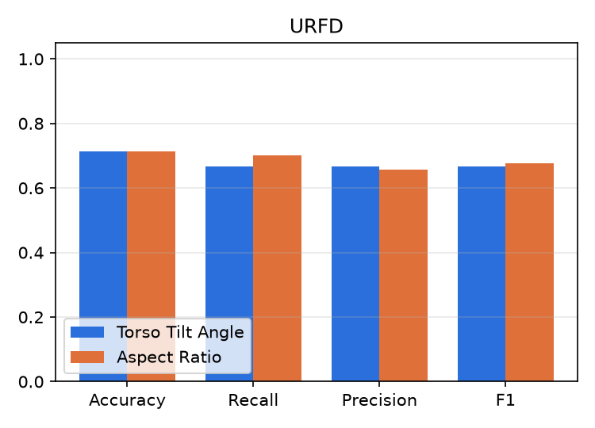
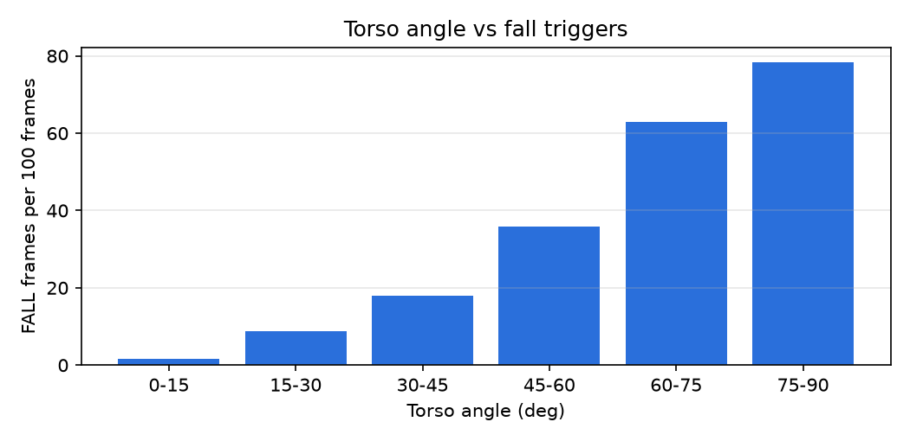

# Fall Detection - Results

## Table III - Performance across datasets (Torso Tilt Angle)

| Dataset | Videos | Acc. | Prec. | Rec. | F1 | Frame-level F1 | FPS |
|---|---|---|---|---|---|---|---|
| URFD | 70 | 71.4% | 66.7% | 66.7% | 66.7% | 46.6% | 4.1 |

## Table IV - Torso Tilt Angle vs Aspect Ratio

| Dataset | Model | Accuracy | Recall | Precision | F1 |
|---|---|---|---|---|---|
| URFD | Torso Tilt Angle | 71.4% | 66.7% | 66.7% | 66.7% |
| URFD | Aspect Ratio | 71.4% | 70.0% | 65.6% | 67.7% |

## Table II - Torso angle vs average fall triggers

| Angle (deg) | Posture | Frames | Avg. triggers / 100 frames |
|---|---|---|---|
| 0-15 | Upright / Standing | 6042 | 2 |
| 15-30 | Slight Bend | 790 | 9 |
| 30-45 | Moderate Lean / Sitting | 494 | 18 |
| 45-60 | High Incline / Pre-fall | 393 | 36 |
| 60-75 | Near-Horizontal / Falling | 410 | 63 |
| 75-90 | Fully Horizontal (Fallen) | 508 | 78 |

## Misclassified clips

- **URFD / angle**: adl-04-cam0.mp4 (FP), adl-05-cam0.mp4 (FP), adl-06-cam0.mp4 (FP), adl-09-cam0.mp4 (FP), adl-10-cam0.mp4 (FP), adl-11-cam0.mp4 (FP), adl-33-cam0.mp4 (FP), adl-34-cam0.mp4 (FP), adl-35-cam0.mp4 (FP), adl-36-cam0.mp4 (FP), fall-03-cam0.mp4 (FN), fall-09-cam0.mp4 (FN), fall-15-cam0.mp4 (FN), fall-19-cam0.mp4 (FN), fall-21-cam0.mp4 (FN), fall-22-cam0.mp4 (FN), fall-23-cam0.mp4 (FN), fall-25-cam0.mp4 (FN), fall-27-cam0.mp4 (FN), fall-29-cam0.mp4 (FN)
- **URFD / aspect**: adl-10-cam0.mp4 (FP), adl-11-cam0.mp4 (FP), adl-30-cam0.mp4 (FP), adl-31-cam0.mp4 (FP), adl-32-cam0.mp4 (FP), adl-33-cam0.mp4 (FP), adl-34-cam0.mp4 (FP), adl-35-cam0.mp4 (FP), adl-36-cam0.mp4 (FP), adl-37-cam0.mp4 (FP), adl-38-cam0.mp4 (FP), fall-17-cam0.mp4 (FN), fall-18-cam0.mp4 (FN), fall-19-cam0.mp4 (FN), fall-21-cam0.mp4 (FN), fall-23-cam0.mp4 (FN), fall-25-cam0.mp4 (FN), fall-26-cam0.mp4 (FN), fall-27-cam0.mp4 (FN), fall-28-cam0.mp4 (FN)
